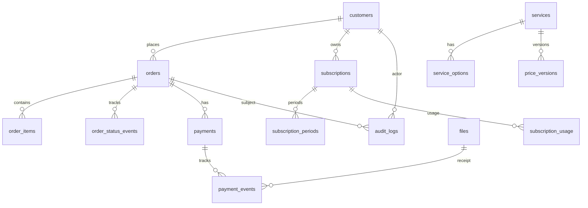

# Архитектура 2.0

Цель: **модульный монолит**, без микросервисов и переписывания ради технологий. Текущий Vanilla frontend и Node.js API сохраняются до поэтапного переноса.

## ERD

### 1. `customers`

`id UUID PK`, `telegram_user_id BIGINT UNIQUE NOT NULL`, `username`, `display_name`, `locale VARCHAR(8) DEFAULT 'ru'`, `created_at`, `updated_at`. Telegram username не используется для авторизации; источник идентичности — проверенный numeric ID.

### 2. `services`

`id UUID PK`, `code VARCHAR UNIQUE`, `kind`, `active BOOLEAN`, `sort_order INTEGER`. Названия локализуемы; заказ хранит собственный snapshot.

### 3. `service_options`

`id UUID PK`, `service_id FK`, `code`, `option_type`, `payload JSONB`, `active`. Параметры длительности, уровня и дополнительных услуг.

### 4. `price_versions`

`id UUID PK`, `service_id FK`, `option_id NULL FK`, `currency CHAR(3)`, `amount_minor BIGINT NULL`, `price_mode fixed/from/individual`, `valid_from`, `valid_to`, `created_at`. Старые версии не изменяются после использования.

### 5. `orders`

`id UUID PK`, `public_number VARCHAR UNIQUE`, `customer_id FK`, `state`, `payment_status`, `work_status`, `amount_minor NULL`, `currency`, `idempotency_key`, `payment_confirmed_at`, `created_at`, `updated_at`, `version INTEGER`. Уникальность `(customer_id, idempotency_key)`.

### 6. `order_items`

`id UUID PK`, `order_id FK`, `service_id NULL FK`, `price_version_id NULL FK`, `service_snapshot JSONB`, `options_snapshot JSONB`, `quantity INTEGER CHECK >0`, `amount_minor NULL`, `currency`. Snapshot неизменяем при последующем изменении прайса.

### 7. `order_status_events`

`id BIGSERIAL PK`, `order_id FK`, `from_state`, `to_state`, `actor_type`, `actor_id`, `reason`, `metadata JSONB`, `created_at`. Append-only; UPDATE/DELETE запрещены приложению.

### 8. `payments`

`id UUID PK`, `order_id FK`, `kind manual`, `status`, `amount_minor`, `currency`, `confirmed_by`, `confirmed_at`, `created_at`. Нет card data или эквайринговых credentials.

### 9. `payment_events`

`id BIGSERIAL PK`, `payment_id FK`, `file_id NULL FK`, `from_status`, `to_status`, `actor_type`, `actor_id`, `reason`, `metadata JSONB`, `created_at`. Отправка, review, reject, repeat request и подтверждение не перезаписывают друг друга.

### 10. `subscriptions`

`id UUID PK`, `customer_id FK`, `plan_code`, `level_code`, `status`, `current_period_id NULL`, `created_at`, `updated_at`.

### 11. `subscription_periods`

`id UUID PK`, `subscription_id FK`, `order_id NULL FK`, `starts_at`, `ends_at`, `included_units INTEGER`, `status`. Продление создаёт/продлевает период явной операцией.

### 12. `subscription_usage`

`id BIGSERIAL PK`, `subscription_id FK`, `period_id FK`, `order_id NULL FK`, `units INTEGER`, `reason`, `created_at`; уникальный external key для идемпотентного списания.

### 13. `files`

`id UUID PK`, `owner_customer_id NULL FK`, `storage_provider telegram/s3`, `storage_key`, `telegram_file_id`, `telegram_file_unique_id`, `mime_type`, `size_bytes`, `sha256`, `message_id`, `chat_id`, `created_at`. Bucket приватный; публичного URL нет.

### 14. `telegram_updates`

`update_id BIGINT PK`, `payload_hash`, `payload JSONB NULL`, `status pending/processing/done/failed`, `attempts`, `next_attempt_at`, `received_at`, `processed_at`, `last_error`. ACK только после INSERT; обработка at-least-once.

### 15. `outbox_events`

`id UUID PK`, `aggregate_type`, `aggregate_id`, `event_type`, `payload JSONB`, `status pending/sent/failed`, `attempts`, `next_attempt_at`, `created_at`, `sent_at`, `last_error`. Финансовый переход и outbox пишутся одной SQL transaction.

### 16. `audit_logs`

`id BIGSERIAL PK`, `actor_type`, `actor_id`, `action`, `subject_type`, `subject_id`, `reason`, `metadata JSONB`, `created_at`. Append-only; чувствительные реквизиты и содержимое чеков не логируются.

## Модули монолита

`catalog`, `orders`, `payments`, `subscriptions`, `files`, `telegram-inbox`, `outbox-relay`, `crm`, `i18n`. Между модулями — вызовы интерфейсов, общая PostgreSQL transaction там, где нужна атомарность.

## Целевой стек

React + TypeScript + Vite, RU/EN; Node.js LTS + TypeScript + Fastify; REST; PostgreSQL + миграции; приватный S3/R2 и CDN только для публичных assets. Внедрение поэтапное, без big bang.

## Инварианты

- Цена определяется сервером и фиксируется snapshot.
- Нет автоматического `paid` по screenshot.
- Owner action проверяет actor, order, customer и текущий state.
- Повторная финансовая операция идемпотентна.
- История статусов и чеков append-only.
- Webhook ACK только после durable save.
- Уведомление не отменяет уже сохранённое финансовое решение.
