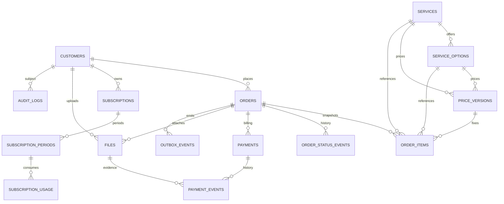

# Архитектура 2.0: модульный монолит и ERD

## Принципы

Целевая система — один deployable backend с модулями `catalog`, `orders`, `payments`, `subscriptions`, `files`, `telegram`, `crm`, `audit`. Микросервисы не нужны: финансовые операции требуют локальных транзакций PostgreSQL, а команде важны простые deploy и rollback.

Текущая реализация остаётся работающей во время миграции. React + TypeScript + Vite, Fastify + TypeScript, PostgreSQL, S3/R2 и CDN вводятся по этапам, а не одной переписью. Существующие логотип, портфолио, стиль и цены сохраняются.

Денежные значения в PostgreSQL — `BIGINT` в минорных единицах (`amount_minor`) плюс ISO currency. Время — `TIMESTAMPTZ`. Любое финансовое решение идемпотентно и имеет actor/reason/time.

## ERD

## Сущности и ключевые поля

### customers

- `id UUID PK`, `telegram_user_id BIGINT UNIQUE NOT NULL`.
- `username`, `display_name`, `locale VARCHAR(8)`, `timezone`.
- `created_at`, `updated_at`, `deleted_at` — soft delete для сохранения финансовых связей.

### services / service_options

- `services`: `id UUID PK`, `code UNIQUE`, `category`, `active`, `name_ru`, `name_en`, `created_at`.
- `service_options`: `id`, `service_id FK`, `code`, `option_type`, `name_ru`, `name_en`, `parameters JSONB`.
- Названия в справочнике можно менять; старые заказы от этого не зависят.

### price_versions

- `id UUID PK`, `service_id NULL FK`, `service_option_id NULL FK`, ровно один владелец цены.
- `amount_minor BIGINT NULL`, `currency CHAR(3)`, `from_price BOOLEAN`, `valid_from`, `valid_to`.
- Версия иммутабельна после публикации. Новый прайс — новая строка, не `UPDATE` прошлой версии.

### orders

- `id UUID PK`, `public_number VARCHAR(16) UNIQUE`, `customer_id FK`.
- `state`, `payment_status`, `work_status`, `total_minor`, `currency`.
- `idempotency_key`, `created_at`, `paid_at`, `updated_at`, `source_channel`.
- `UNIQUE(customer_id, idempotency_key)` предотвращает дубли при retry/restart.
- `state` включает `pending_payment`, `payment_submitted`, `payment_review`, `payment_rejected`, `paid`, `in_progress`, `completed`, `cancelled`.

### order_items

- `id`, `order_id FK`, `service_id NULL FK`, `service_option_id NULL FK`, `price_version_id NULL FK`.
- `title_snapshot`, `parameters_snapshot JSONB`, `quantity`, `unit_amount_minor`, `total_amount_minor`, `currency`.
- Снимок включает название, длительность/объём, срок, extras и цену на момент создания. Изменение прайса не трогает эти строки.

### order_status_events

- `id BIGSERIAL PK`, `order_id FK`, `from_state`, `to_state`, `actor_type`, `actor_id`, `reason`, `created_at`.
- Append-only: запрещены UPDATE/DELETE на уровне привилегий БД.

### payments / payment_events

- `payments`: `id`, `order_id FK`, `kind='manual_bank_transfer'`, `status`, `amount_minor`, `currency`, `confirmed_by`, `confirmed_at`, `created_at`.
- `payment_events`: `id`, `payment_id FK`, `event_type`, `from_status`, `to_status`, `actor_type`, `actor_id`, `reason`, `receipt_file_id NULL FK`, `created_at`.
- Скриншот создаёт только review-событие. `paid` возникает исключительно после авторизованного решения владельца.
- Уникальный ключ идемпотентности действия: `(payment_id, event_type, client_action_id)`.

### subscriptions / subscription_periods / subscription_usage

- `subscriptions`: `id`, `customer_id`, `plan_code`, `level_code`, `status`, `current_period_id`.
- `subscription_periods`: `id`, `subscription_id`, `order_id NULL`, `starts_at`, `ends_at`, `included_units`.
- `subscription_usage`: `id`, `period_id`, `order_item_id NULL`, `units`, `created_at`.
- Продление создаёт/продлевает период идемпотентно; повтор callback не добавляет 30 дней повторно.

### files

- `id UUID PK`, `customer_id`, `order_id NULL`, `purpose`, `storage_provider`, `storage_key`.
- `telegram_file_unique_id`, зашифрованный/ограниченный `telegram_file_id`, `mime_type`, `size_bytes`, `sha256`, `created_at`.
- Файл приватный. Доступ проверяется по заказу/владельцу; публичный CDN используется только для портфолио, не для чеков.

### telegram_updates

- `update_id BIGINT`, `payload_hash`, `payload JSONB`, `status`, `attempts`, `next_attempt_at`, `received_at`, `processed_at`, `last_error`.
- В production `PRIMARY KEY(update_id)`; текущий JSON дополнительно использует payload hash для совместимости со старыми тестовыми update_id.
- Запись вставляется до ACK. Обработчик at-least-once, бизнес-операции идемпотентны.

### outbox_events

- `id UUID`, `aggregate_type`, `aggregate_id`, `event_type`, `payload JSONB`, `idempotency_key UNIQUE`.
- `status`, `attempts`, `available_at`, `sent_at`, `last_error`.
- В PostgreSQL создаётся в одной транзакции с финансовым событием. Relay не удаляет запись после отправки.

### audit_logs

- `id BIGSERIAL`, `actor_type`, `actor_id`, `entity_type`, `entity_id`, `action`, `reason`, `metadata JSONB`, `created_at`.
- Доступ только сервисной роли на INSERT/SELECT. Не хранить токены, реквизиты и содержимое чека.

## Транзакции

`confirm payment` в PostgreSQL:

1. `SELECT ... FOR UPDATE` платежа и заказа.
2. Проверить owner, customer binding и допустимый текущий статус.
3. INSERT append-only payment/status/audit events.
4. UPDATE заказа и платежа.
5. INSERT outbox с уникальным ключом.
6. COMMIT; только затем ACK обработчика как выполненного.

Это устраняет текущее ограничение JSON «один активный инстанс» и окно между несколькими файловыми записями.
